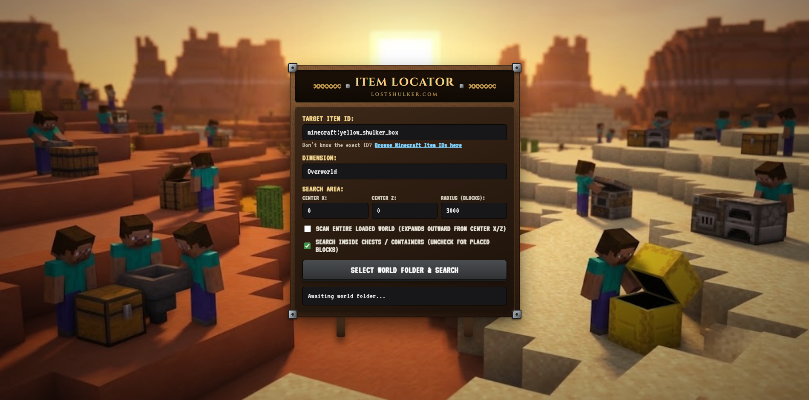

# LostShulker

LostShulker helps you locate items in Minecraft Java Edition world saves. Search inside containers such as chests, or look for placed blocks and block entities.

Website: https://lostshulker.com

## Getting started

1. Open [lostshulker.com](https://lostshulker.com) in a recent desktop browser that supports folder selection (for example, Chrome or Edge).
2. Enter the item ID you want to find. You can enter an item name such as `yellow_shulker_box`; the site adds the `minecraft:` namespace automatically.
3. Choose the dimension, then set a centre and radius — or select the option to scan all saved region files in that dimension.
4. Select the individual world folder when your browser opens its folder picker. Choose the folder containing `level.dat` and the `region` folder. Do not choose the parent `saves` folder.

### Common Java Edition save locations

- **Windows:** `%appdata%\.minecraft\saves`
- **macOS:** `~/Library/Application Support/minecraft/saves`
- **Linux:** `~/.minecraft/saves`

If you use a launcher or custom game directory, look for the `saves` folder inside that launcher's game directory.

## Privacy and offline use

The selected world folder is opened with read-only access. The search runs locally in your browser; world files and scan results are not uploaded to a LostShulker server.

The page loads its NBT scanning library from jsDelivr and may load fonts from Google. Keep an internet connection until the page and scanner have finished loading. You can then disconnect and use the scanner in the already-loaded tab. Refreshing or reopening the page while offline may not work.

LostShulker does not modify your world save.

## Compatibility

LostShulker reads Java Edition region files (`.mca`). It does not scan Bedrock Edition worlds.
